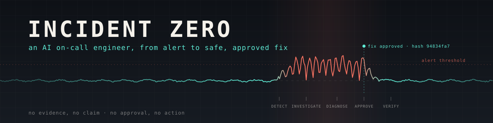
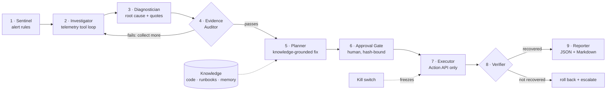
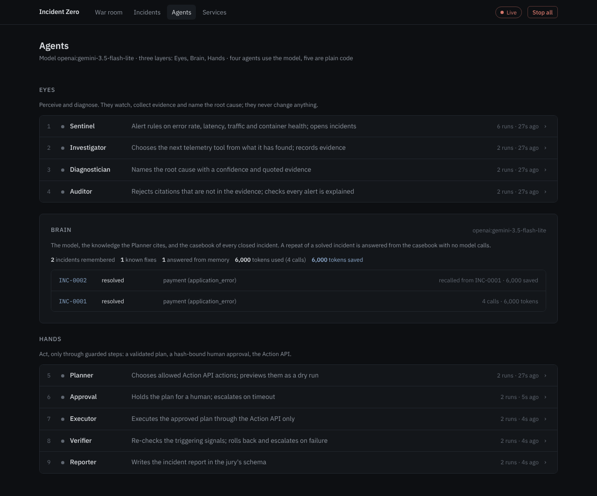
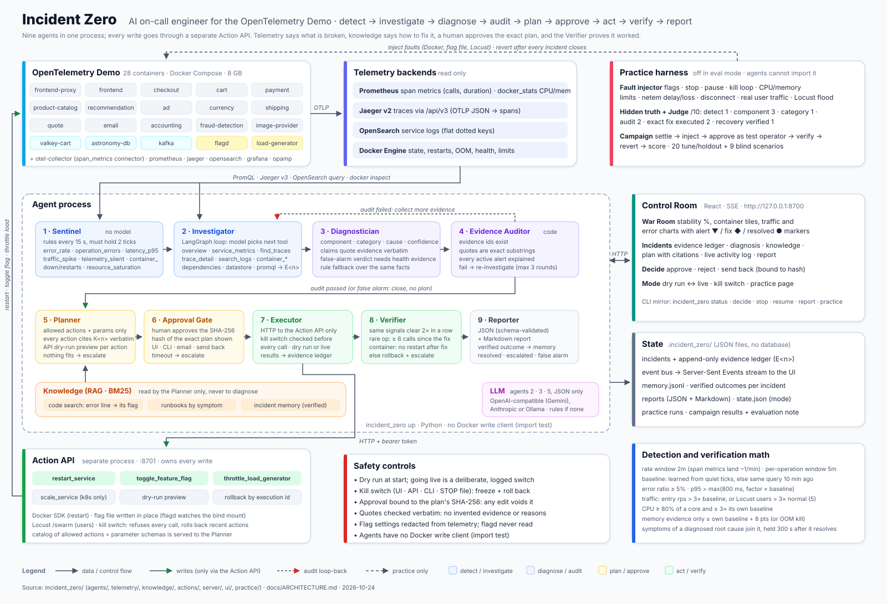
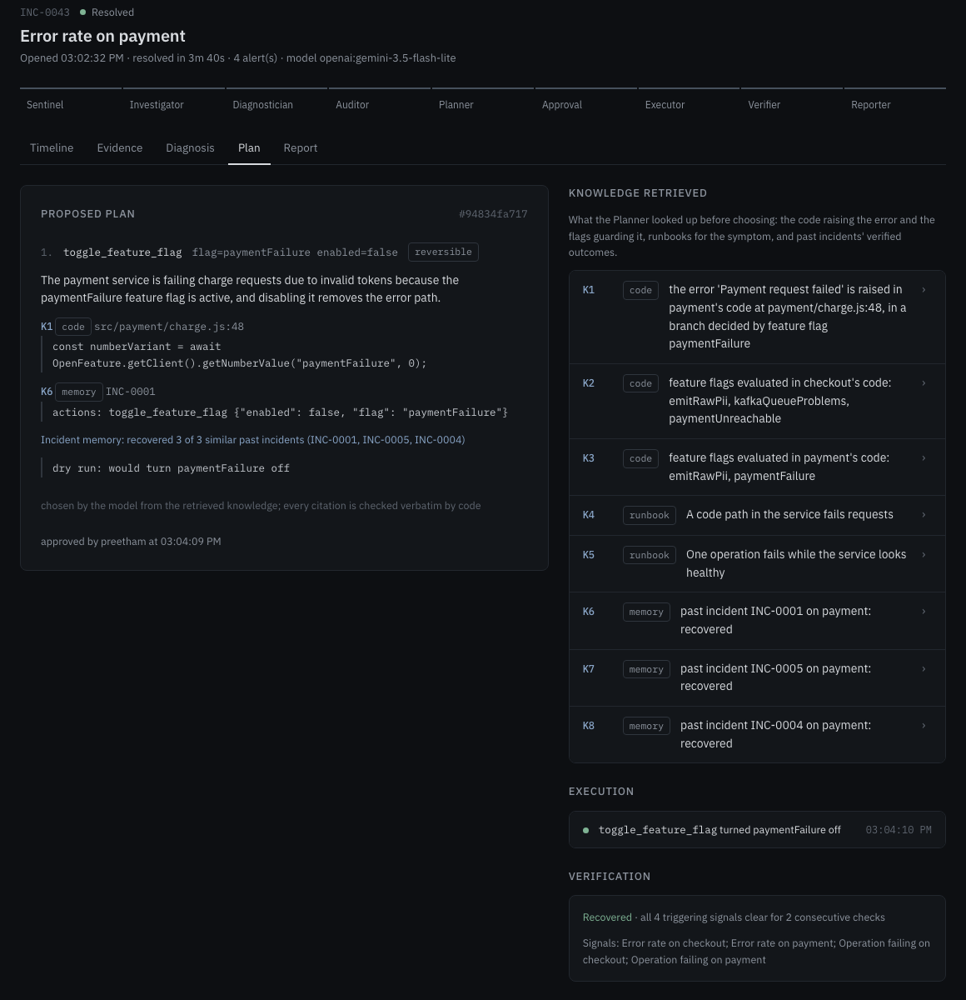
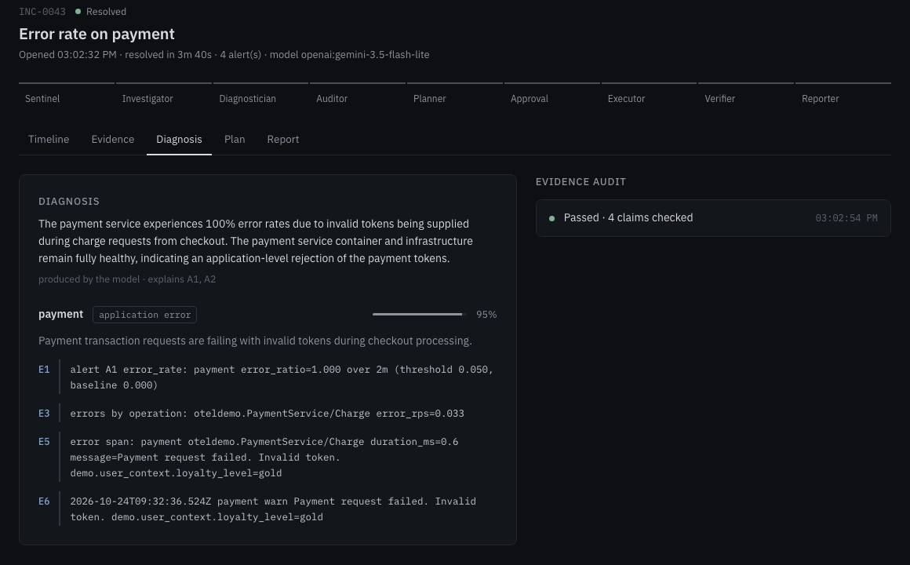
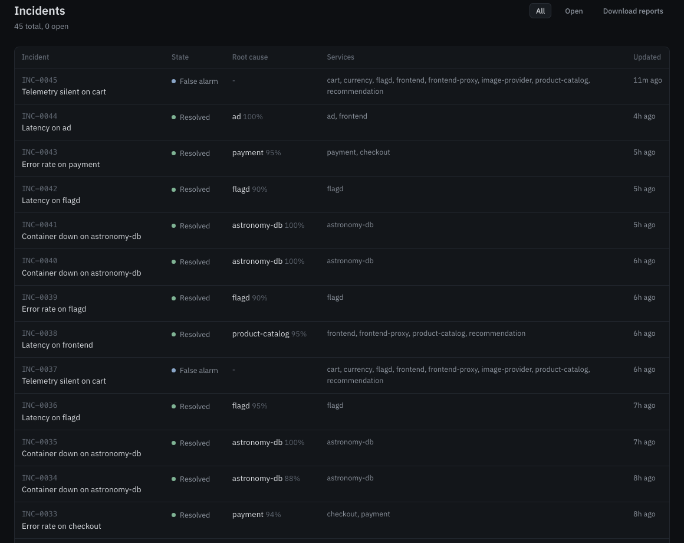

<div align="center">



<br>


**[Results](#results)** · **[How it works](#how-it-works)** · **[Eyes, Brain, Hands](#eyes-brain-and-hands)** · **[Control Room](#the-control-room)** · **[Quickstart](#quickstart)** · **[Safety](#safety-by-construction)** · **[Docs](#documentation)**

</div>

---

Incident Zero is an AI on-call engineer for the [OpenTelemetry Demo](https://github.com/open-telemetry/opentelemetry-demo).
It handles an incident from alert to report:

- **Detects** the incident from live telemetry.
- **Investigates** with real traces, metrics, logs and container state.
- **Names the root cause**, citing evidence that exists in the collected data.
- **Proposes a fix** chosen only from the Action API's allowed actions and grounded in retrieved knowledge: the code
  that raises the error, runbooks, and past fixes that were verified.
- **Waits for a human** to approve the exact plan shown.
- **Executes** through the Action API only, then **verifies** recovery. If recovery fails it rolls back and
  escalates.
- **Writes a report** in JSON and Markdown.
- **Remembers every incident.** A repeat of one it already fixed is answered from its casebook with **no model
  calls**, still audited and still approved by a human. Every model call is metered in tokens.

Built for the Bosch hackathon *"Incident Zero: Build an AI On-Call Engineer"* at PES University.

> **No evidence, no claim. No approval, no action.** The model can suggest a diagnosis and a plan. Code checks
> every quote against the evidence ledger, every action against the allowed catalog, and every approval against a
> SHA-256 hash of the exact plan shown. The agent process has no Docker write client: changes go through the Action
> API, a separate process.

## Results

On the full running demo (28 containers, real telemetry, real Action API calls, Gemini `gemini-3.5-flash-lite`), the
practice Judge scored **10 different injected faults at 10/10** against hidden ground truth:

| Fault | Diagnosis | Fix executed |
|---|---|---|
| Payment charge fails | payment · application error | `paymentFailure` flag off |
| Catalog fails for one product | product-catalog · application error | `productCatalogFailure` flag off |
| Recommendation cache leak | recommendation · memory | flag off + restart |
| Ad service high CPU | ad · CPU | `adHighCpu` flag off |
| Ad service GC pressure | ad | `adManualGc` flag off |
| Catalog database down | astronomy-db · container down | restart `astronomy-db` |
| Quote packet loss | quote · network | restart `quote`, `shipping` |
| Valkey cache down | valkey-cart · container down | restart `valkey-cart` |
| Cart service stopped | cart · container down | restart `cart` |
| Catalog latency | product-catalog · network | restart `product-catalog` |

The full write-up, including misses, invalid runs and bugs found while testing, is in
[LIVE_RESULTS](incident_zero/docs/LIVE_RESULTS.md). Example reports:
[INC-0002](incident_zero/docs/live_reports/INC-0002.md) · [INC-0003](incident_zero/docs/live_reports/INC-0003.md).

## How it works

Nine agents run in one process. Five of them are plain code and four use the model. Each model step has a
deterministic fallback, so the system still works with no model configured.



| # | Agent | Model | Job |
|---|---|---|---|
| 1 | **Sentinel** | no | Alert rules on error rate, p95 latency, traffic, silence and container state. Correlates alerts into one incident |
| 2 | **Investigator** | yes (LangGraph tool loop; playbook fallback) | Picks the next telemetry tool from what it has found so far. Every result becomes evidence `E<n>` |
| 3 | **Diagnostician** | yes (rules fallback) | Component, root cause, confidence, and claims that quote the evidence |
| 4 | **Evidence Auditor** | no | Checks that cited ids exist, quotes are verbatim and every alert is explained. Otherwise sends the incident back to the Investigator |
| 5 | **Remediation Planner** | yes (rules fallback) | Retrieves knowledge `K<n>` and chooses allowed actions only. Each action cites knowledge verbatim, is validated by code, previewed as a dry run and hashed |
| 6 | **Approval Gate** | human | Approve, reject or send back. A timeout escalates |
| 7 | **Executor** | no | Calls the Action API only. Checks the kill switch before every call |
| 8 | **Verifier** | no | Re-checks the triggering signals. Rolls back and escalates if they have not recovered |
| 9 | **Reporter** | wording only | Code builds the report from the incident record and validates it against the jury's schema |

### How the agent knows which fix to propose

Telemetry shows what is broken but not how to fix it. Once the diagnosis passes the audit, the Planner retrieves
three kinds of knowledge (BM25-ranked):

1. **Code.** It searches the demo's source for the error text from the audited evidence. The line that raises the
   error, and the feature-flag condition that decides whether that line runs, become knowledge (for example
   `src/payment/charge.js:48`, guarded by `paymentFailure`). It finds flags by reading how the code evaluates them,
   not from a hand-written list.
2. **Runbooks** ([`knowledge/runbooks/*.md`](incident_zero/knowledge/runbooks)), organised by symptom. They say what
   fixes each kind of failure, and when no allowed action does, which means escalate.
3. **Incident memory.** Every live fix the Verifier judged is stored with its outcome, so a plan can show a track
   record such as *"recovered 3 of 3 similar past incidents"*.

Whether a fix was right is only proven afterwards. The triggering signals must stay clear for two consecutive
checks. If they do not, the Verifier rolls back and escalates.

## Eyes, Brain and Hands

The agents are grouped in three layers ([BRAIN](incident_zero/docs/BRAIN.md) has the details):

| Layer | What | Never |
|---|---|---|
| **Eyes** ([`eyes/`](incident_zero/eyes/__init__.py)) | Sentinel, Investigator, Diagnostician, Evidence Auditor: perceive and diagnose | change anything |
| **Brain** ([`brain/`](incident_zero/brain/__init__.py)) | the model, knowledge, the **casebook** of every closed incident, the **token meter**, **recall** | act |
| **Hands** ([`hands/`](incident_zero/hands/__init__.py)) | Planner, Approval Gate, Executor, Verifier, Reporter: act through guarded steps | act without a human approval |

**Known incidents cost no model calls.** When an incident's alerts match one the agents already resolved live (fix
verified, and the last live attempt did not fail), the Brain recalls it. The Investigator runs its playbook, the
rules diagnose and must name the same component and failure as the past case, the Evidence Auditor still checks
every quote, the Planner proposes the case's verified fix citing incident memory, and a human still approves the
hashed plan. If the diagnosis disagrees, the audit fails or the fix no longer validates, recall is abandoned and the
full pipeline runs with the model.

**Every model call is metered.** Tokens are read from each provider's response (OpenAI-compatible, Anthropic,
Ollama, LangGraph's `usage_metadata`) and stored per incident and per agent; a recalled incident records the tokens
its original reasoning took as tokens saved.



<sub>**Agents page.** The Brain panel after a repeat incident was answered from memory. From the offline test
scenario (fake telemetry, a scripted model reporting 1,500 tokens per call), not a live run.</sub>

### Architecture



The one-page version is in [ARCHITECTURE](incident_zero/docs/ARCHITECTURE.md).

## The Control Room

A React + Vite app served at `http://127.0.0.1:8700`. It streams agent activity over Server-Sent Events and keeps
**Stop all** in the header at all times.



<sub>**Plan and approval.** The proposed action cites the exact code line that raises the error (`K1`) and past
verified fixes (`K6`). The right-hand column shows the knowledge the Planner retrieved, then the execution and the
verification result. The plan hash (`#94834fa717`) is what the approver signs.</sub>

<table>
<tr>
<td width="50%"></td>
<td width="50%"></td>
</tr>
<tr>
<td><sub><b>Diagnosis.</b> Root cause, category and confidence. Every claim quotes evidence (<code>E1</code>, <code>E3</code>, …) that the Auditor checked verbatim.</sub></td>
<td><sub><b>Incidents.</b> Every incident with its state, root cause, confidence and affected services. Reports download as JSON + Markdown.</sub></td>
</tr>
</table>

Pages: **War room** (live activity) · **Incidents** (timeline, evidence, diagnosis, plan, report) · **Agents** ·
**Services** (request metrics against the baseline) · **Practice**.

## Quickstart

You need Python 3.10+, Node 20+ (for the UI build) and Docker Desktop with about 6–8 GB of memory.

```bash
git clone https://github.com/preeeetham/ground_zero.git && cd ground_zero
python3 -m venv .venv && . .venv/bin/activate
pip install -e '.[dev,incident_zero]'

git clone --depth 1 https://github.com/open-telemetry/opentelemetry-demo ~/Developer/opentelemetry-demo
cp incident_zero/incident_zero.example.yaml incident_zero.yaml   # set demo_dir
cp .env.example .env                                             # model + optional SMTP

incident_zero ui-build        # builds the Control Room
pytest                        # 105 tests, no Docker or model needed
```

**Model.** Set `LLM_PROVIDER`, `LLM_MODEL`, `LLM_BASE_URL` and `LLM_API_KEY` in `.env`. Any OpenAI-compatible
endpoint works (OpenAI, Gemini, Groq, OpenRouter), as do Anthropic and a local Ollama model. With no model
configured, every agent uses its deterministic path. The SMTP settings in `.env` turn on approval and escalation
emails.

### Run

```bash
incident_zero demo up          # the demo + Jaeger, Prometheus, OpenSearch, Grafana
incident_zero action-api       # the mock Action API, in its own process
incident_zero up               # Sentinel + agents + Control Room on http://127.0.0.1:8700
incident_zero up --eval        # the same, with practice mode switched off entirely
```

To trigger an incident, inject a fault from outside: use the demo's flag page at `http://localhost:8080/feature`,
run `docker stop|pause|update`, or use `pumba`. Then watch the War room.

<details>
<summary><b>CLI reference</b></summary>

| Command | What it does |
|---|---|
| `incident_zero status` | Mode, kill switch state, recent incidents |
| `incident_zero decide INC-0001 approve --as <name>` | Approve, reject or send back a plan |
| `incident_zero stop --as <name>` / `resume` | Engage or release the kill switch. Works without the server |
| `incident_zero report INC-0001` | Print an incident report |
| `incident_zero practice list \| run <id> \| runs` | Practice scenarios (not in eval mode) |
| `incident_zero practice run blind` | Inject a hidden scenario at random. Reveals which one only after scoring |
| `incident_zero practice campaign blind --as <name> --live` | Run every blind scenario end to end |

</details>

## Safety by construction

| Guard | Behaviour |
|---|---|
| **Dry run first** | Starts in dry run. Going live is a deliberate, confirmed and logged switch shown in the top bar |
| **Hash-bound approval** | The plan (actions, parameters, reasons, citations) is hashed with SHA-256 when it is shown. Approval needs the approver's name and that hash, so a plan that changed after it was displayed cannot be approved |
| **Timeout escalates** | If nobody decides within `approval_timeout_s`, the incident escalates and nothing runs. *Send back* requires a note, which goes to the Investigator |
| **Kill switch** | *Stop all* (UI, `POST /api/stop`, CLI or the STOP file) freezes the agents, makes the Action API refuse every call, and rolls back reversible actions from the last `kill_rollback_window_s`. It stays on until someone explicitly resumes |
| **Action API only** | The agent process holds an HTTP client, not a Docker write client. An import test enforces this |
| **No invented evidence** | Code checks diagnosis quotes (`E<n>`) and plan citations (`K<n>`) verbatim. Anything unverifiable is dropped before a human sees it |
| **No flag peeking** | Feature-flag data is stripped from every trace, log and metric before it becomes evidence. flagd's logs, the flag file and the practice ground truth are never read. Flag knowledge comes from service code and is used only for planning |
| **Verified or rolled back** | The triggering signals must stay clear for two consecutive checks. Otherwise the Verifier rolls back and escalates |

## Documentation

| Document | What it covers |
|---|---|
| [ARCHITECTURE](incident_zero/docs/ARCHITECTURE.md) | One-page architecture, components, decision process, safety controls |
| [BRAIN](incident_zero/docs/BRAIN.md) | Eyes, Brain and Hands; the casebook, the token meter and known-incident recall |
| [REQUIREMENTS](incident_zero/docs/REQUIREMENTS.md) | The brief's requirements and how each one is met |
| [LIVE_RESULTS](incident_zero/docs/LIVE_RESULTS.md) | Every live run on the real demo, including misses and the fixes they led to |
| [BUILD_LOG](incident_zero/docs/BUILD_LOG.md) | What was built, in what order, and how |
| [CHECKPOINTS](incident_zero/docs/CHECKPOINTS.md) · [HANDOFF](incident_zero/docs/HANDOFF.md) | Milestones and the operator handoff |
| [Report schema](incident_zero/schema/incident_report.schema.json) | The JSON schema every report is validated against |
| [TEAM_FORM](incident_zero/docs/TEAM_FORM.md) · [brief](incident_zero/docs/hackathon_brief.json) | Submission form and the hackathon brief |

## Repository layout

```
incident_zero/
  eyes/          the Eyes layer: sentinel, investigator, diagnostician, auditor
  brain/         the Brain layer: casebook, token meter, known-incident recall (plus the model and knowledge/)
  hands/         the Hands layer: planner, approval, executor, verifier, reporter
  agents/        the nine agents' implementations
  telemetry/     Prometheus, Jaeger v3, OpenSearch and Docker backends; the Investigator's tools
  knowledge/     code index, runbooks, incident memory, BM25 search
  actions/       Action API client, action catalog, feature flags, the mock Action API server
  server/        HTTP + SSE server behind the Control Room
  ui/            Control Room (React, Vite, TypeScript)
  practice/      fault simulator, scenarios, campaigns and the Judge
  schema/        incident report JSON schema
  tests/         offline test suite with in-memory fakes for Prometheus, Jaeger, Docker and logs
  docs/          architecture, requirements, live results, real incident reports
  orchestrator.py · safety.py · store.py · evidence.py · redact.py · llm*.py · cli.py
```

## Known limitations

- The Action API's parameter names are an assumption. The real API plugs in through one adapter,
  [`actions/client.py`](incident_zero/actions/client.py).
- Faults caused by a CPU or memory limit, or by a detached network, have no allowed fix, so the agent escalates.
- `toggle_feature_flag` is chosen by reading the demo's **source code** to find which flag guards the failing line.
  Flag values are never read.
- With the smallest model tier, some diagnoses fall back to rules. The Control Room labels these "backup rules".
- Kafka (`compose.full.yaml`) is off by default to fit in 8 GB of Docker memory, so Kafka incidents are untested.
- Accuracy on unseen incidents is measured with the practice Judge, not guaranteed.
- Recall matches incidents by their alerts, then requires the rule-based diagnosis to agree. A fault whose alerts and
  rule diagnosis look like a past one but needs a different fix would be proposed the old fix; the human approval
  and the Verifier's rollback are the backstop.
- Token savings are measured on the original incident's own calls; they are only estimated when its provider reported
  no usage.

## Acknowledgements

Application under test: the [OpenTelemetry Demo](https://github.com/open-telemetry/opentelemetry-demo) (Apache-2.0).
Fault injection: [Pumba](https://github.com/alexei-led/pumba). Agent loop:
[LangGraph](https://github.com/langchain-ai/langgraph).
