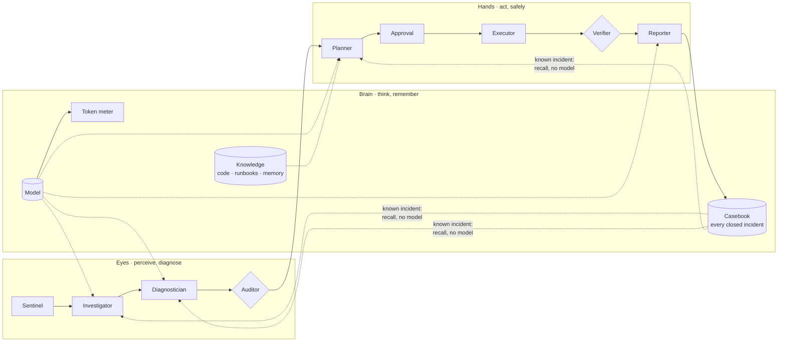

# Eyes, Brain and Hands: the knowledge layer

Incident Zero's nine agents are grouped in three layers, each with one job:

| Layer | Package | Agents / parts | Job |
|---|---|---|---|
| **Eyes** | [`eyes/`](../eyes/__init__.py) | Sentinel, Investigator, Diagnostician, Evidence Auditor | Perceive and diagnose. Watch telemetry, collect evidence, name the root cause. Never change anything |
| **Brain** | [`brain/`](../brain/__init__.py) | the model, knowledge, casebook, token meter, recall | Think and remember. Serve the Eyes and the Hands. Never act |
| **Hands** | [`hands/`](../hands/__init__.py) | Planner, Approval Gate, Executor, Verifier, Reporter | Act, only through guarded steps: a validated plan, a hash-bound human approval, the Action API |

## The casebook: every incident is remembered

`brain/casebook.py` appends every closed incident to `data_dir/casebook.jsonl`, whatever the outcome: resolved,
escalated, rejected, false alarm or dry run. Each entry records the alert fingerprint (`rule:service` pairs), the
diagnosis, the actions that ran live, whether the Verifier saw recovery, and what the model cost.

Incident memory (`knowledge/memory.py`) is unchanged: it keeps only live, verified fixes, because the Planner cites
it. The casebook is the wider record the Brain uses to decide what it already knows.

## The token meter: what the model cost

`brain/meter.py` counts every model call per incident and per agent:

- one-shot JSON calls (Diagnostician, Planner, Reporter) read the provider's own `usage`: OpenAI-compatible
  `prompt_tokens`/`completion_tokens`, Anthropic `input_tokens`/`output_tokens`, Ollama
  `prompt_eval_count`/`eval_count`;
- the Investigator's LangGraph tool loop reads each turn's `usage_metadata`;
- if a provider reports nothing, the count is estimated from text length (about 4 characters per token) and the
  incident is marked `estimated`.

The incident is identified by a context variable that the orchestrator's worker sets (one thread per incident), and
the agent by the status board's `working(agent, ...)` block, so no agent has to pass either along. Every incident
carries `tokens: {calls, prompt_tokens, completion_tokens, estimated, by_agent}`.

## Recall: a known incident costs no model calls

When an incident opens, the Brain looks it up in the casebook. It is **known** when:

1. its alerts match a past incident's with Jaccard similarity of at least `recall_min_similarity` (default 0.6);
2. that past incident was **resolved live with recovery verified** (dry runs, rollbacks and escalations never
   count);
3. the most recent live attempt on those alerts did not fail, and the fix has at least `recall_min_successes`
   verified recoveries (default 1).

A known incident goes through the **same phases with no model calls**, and with every check still in place:

| Phase | Normal incident | Known incident |
|---|---|---|
| Investigate | model tool loop (LangGraph) | deterministic playbook |
| Diagnose | model, rules as fallback | rules; must name the **same component and category** as the case |
| Audit | code checks every quote | unchanged |
| Plan | model chooses, citing knowledge | the case's verified actions, citing its incident-memory entry |
| Validate + preview | code + Action API dry run | unchanged |
| Approve | human, hash-bound | unchanged |
| Verify | re-check the signals | unchanged |
| Report | model writes the summary | code writes the summary |

Recall is **abandoned**, and the incident goes through the full pipeline with the model, when the rules diagnose a
different component or failure, the evidence audit fails, or the stored fix no longer validates against the Action
API's catalog. The reason is shown on the incident and in its report's limitations.

Each recalled incident records the model calls and tokens that reasoning out the original case took
(`recall.tokens_saved`). That is the case's own measurement, followed back through earlier recalls to the incident
that was actually reasoned, or the average reasoned incident if none was measured.

## Where to see it

- **Agents** page: the Eyes, the Brain panel (incidents remembered, known fixes, answered from memory, tokens used
  and saved) and the Hands.
- **Incident** page: model calls and tokens for the incident, and a "Known incident" line naming the case.
- `GET /api/brain`: the casebook totals and the 20 most recent cases.

Screenshots: [control-room-brain.png](assets/control-room-brain.png),
[control-room-recall.png](assets/control-room-recall.png). Both are from the offline test scenario (fake telemetry,
a scripted model reporting 1,500 tokens per call), not a live run.

## Settings

| Setting | Default | |
|---|---|---|
| `recall_enabled` | `true` | `IZ_RECALL_ENABLED=false` turns recall off; the casebook and the meter keep working |
| `recall_min_similarity` | `0.6` | alert-fingerprint overlap for an incident to count as known |
| `recall_min_successes` | `1` | live, verified recoveries of a fix before it is reused |

## Tests

[`tests/test_brain.py`](../tests/test_brain.py): a repeat incident is investigated, diagnosed, planned and reported
with zero model calls and still needs approval; recall is abandoned when the evidence disagrees with the case; dry
runs, escalations and a fix that failed last time never make an incident known; token usage is read from each
provider and attributed to the right incident and agent; every closed incident is stored once.
